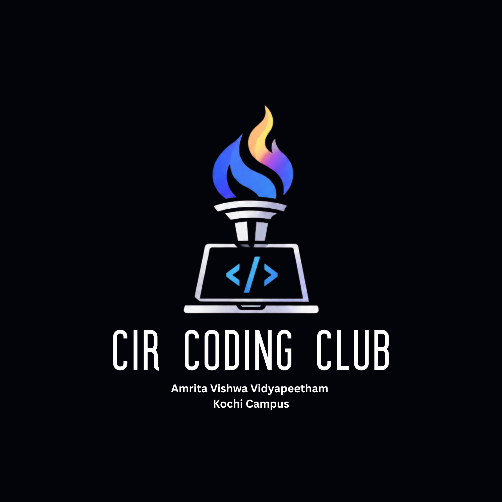

  

  <h1>🔥 CIR CODING CLUB</h1>
  <h3>Where curiosity becomes code — and code becomes possibility.</h3>

  

    <strong>Corporate and Industry Relations (CIR)</strong> 
    Amrita Vishwa Vidyapeetham · Kochi Campus
  

  

    <a href="#-our-mission">Our Mission</a> ·
    <a href="#-what-we-build">What We Build</a> ·
    <a href="#-get-involved">Get Involved</a> ·
    <a href="#-our-code">Our Code</a>
  

  
  
  

⚡ The spark behind the screen
Every great product starts with a question. Every breakthrough starts with someone willing to experiment. And every great developer starts somewhere.

CIR Coding Club is a student-driven coding community at Amrita Vishwa Vidyapeetham, Kochi Campus, built to bring curious minds together through technology, collaboration, and hands-on learning.

We believe coding is more than syntax. It's a way to solve problems, turn ideas into working products, and create things that matter.

We learn together. We build together. We get better together.
Think boldly. Build relentlessly. Leave a mark.

🎯 Our mission
- 🧠 Learn by doing — turn concepts into practical skills and real projects.
- 🛠️ Build with purpose — create useful solutions, not just tutorial clones.
- 🤝 Grow together — share knowledge, review code, and help peers level up.
- 🚀 Explore what's next — experiment with AI, web development, app development, cybersecurity, and emerging technologies.
- 🌉 Connect learning with opportunity — develop the confidence and portfolio to take on hackathons, internships, and industry challenges.
🧪 What we build

🧭 Explore	⚙️ Create	🌱 Grow
Programming & problem-solving	Websites & applications	Peer learning
AI & emerging technology	Prototypes & experiments	Hackathons & challenges
Open-source development	Tools that solve real problems	Portfolio-ready projects

Our interests evolve with our members. Bring a new idea, a new technology, or a problem worth solving — there's room to explore it here.
🧰 The developer toolbox

  

These are examples of technologies our community can explore, not a fixed or exhaustive list. The best tool is the one that helps solve the problem well.
🏗️ From idea to impact
       CURIOSITY
           │
           ▼
       ASK A QUESTION
           │
           ▼
       EXPLORE & LEARN
           │
           ▼
       BUILD A PROTOTYPE
           │
           ▼
       TEST · SHARE · IMPROVE
           │
           ▼
       SHIP SOMETHING USEFUL
We value the process as much as the outcome: experiments, failed builds, thoughtful feedback, and the small improvements that make a project better.
🤝 Get involved
You don't need to know everything to get started. You just need the willingness to learn and contribute.
- New to coding? Start small, ask questions, and learn in public.
- Already building? Share your work, collaborate, and help others grow.
- Have an idea? Bring it forward. Let's explore what it could become.
- Want to contribute? Browse our repositories, open an issue, improve documentation, or submit a pull request.
Your first contribution
1. Explore the repositories in this organization.
2. Find a project or issue that interests you.
3. Read its README.md and contribution guidelines, if available.
4. Fork the repository and create a focused branch.
5. Make your change, test it, and write a clear commit message.
6. Open a pull request explaining what you changed and why.
Each repository may have its own contribution rules, so check them before submitting.
🧑‍🚀 Our community principles
- Curiosity over ego. There are no silly questions when we're here to learn.
- Progress over perfection. Start small; improve with every iteration.
- Collaboration over competition. Someone else's growth doesn't limit yours.
- Respect in every review. Critique the code, support the person.
- Build responsibly. Consider accessibility, privacy, security, and real-world impact.
📡 Find your next starting point

  One idea can start a project. One project can start a journey.

  Explore our repositories, share an idea, or collaborate with fellow developers.
  <!-- Replace the placeholder URL below with the club's actual GitHub organization/profile URL. -->
  

  

  Made with curiosity, collaboration, and a little caffeine ☕

  CIR Coding Club · Amrita Vishwa Vidyapeetham, Kochi Campus

🧾 Our code
We aim to keep this community welcoming, respectful, and constructive. Be kind to people, thoughtful with feedback, and responsible with what you build and share.

The next great idea could be yours. Let's build it. 🔥
